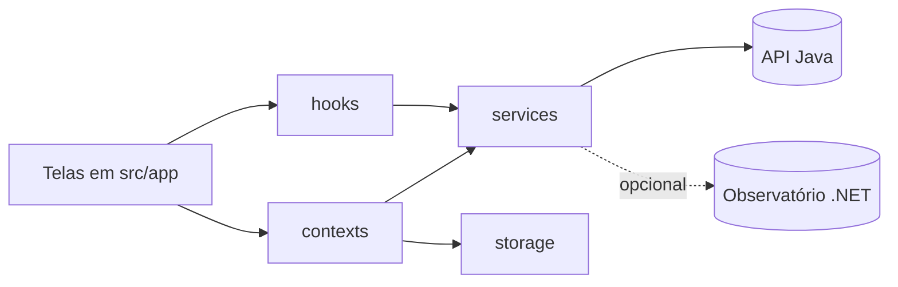

# Valence Mobile

Aplicativo do **Valence**, rede pública e colaborativa de vigilância fitossanitária para pequenos produtores de milho, tomate e batata. Global Solution FIAP 2026/2, tema **CitizenTech**, disciplina **Mobile Application Development**.

O produtor fotografa a folha atacada e registra a ocorrência. A API Java faz a triagem com IA, avisa os vizinhos da mesma cultura em um raio de 10 km com um alerta de **suspeita** e encaminha o caso para um agrônomo, que confirma ou descarta. Casos confirmados vão para o mural da região e para os dados abertos, sem dados pessoais.

## Integrantes

| Nome | RM |
| --- | --- |
| Henrique Martins | RM 563620 |
| Guilherme Macedo | RM 562396 |
| Pedro Henrique | RM 563405 |

## Vídeo de demonstração

Vídeo de até 5 minutos no YouTube: **https://youtu.be/5gfchfm-znk**.

## Benefício ao cidadão

Pequenos produtores costumam descobrir uma praga quando ela já se espalhou pela vizinhança. O Valence encurta esse tempo:

- o produtor registra o problema em menos de um minuto, com foto, cultura e propriedade;
- recebe uma triagem com hipóteses, severidade e cuidados imediatos, sempre marcada como suspeita;
- os vizinhos da mesma cultura recebem um alerta com a distância aproximada, sem saber quem registrou;
- o agrônomo confirma o caso, e só então ele aparece como confirmado no mural e nos dados abertos;
- o registro funciona mesmo sem sinal: a ocorrência fica na fila do aparelho e é enviada quando a conexão volta.

ODS relacionados: 2 (Fome zero e agricultura sustentável), 9 (Inovação e infraestrutura), 10 (Redução das desigualdades) e 13 (Ação contra a mudança do clima).

## Funcionalidades por papel

| Papel | O que faz no app |
| --- | --- |
| Produtor | Cadastra propriedades, registra ocorrências com foto (câmera ou galeria), acompanha triagem e laudo, edita ou exclui enquanto a ocorrência não foi analisada, recebe alertas de casos próximos e marca como lidos |
| Agrônomo | Vê a fila de análise por severidade, abre a ocorrência com a triagem da IA, emite o laudo (confirmada, descartada ou mais informações) e modera o mural |
| Gestor | Modera publicações denunciadas (manter ou remover) |
| Todos | Mural da região com publicações, comentários e denúncia; perfil; Observatório público (opcional); Sobre o App |

## Telas

| # | Tela | Rota | Papel | Requisito |
| --- | --- | --- | --- | --- |
| 1 | Login | `/login` | público | 03 |
| 2 | Cadastro | `/cadastro` | público | 03 |
| 3 | Início com alertas próximos | `/inicio` | Produtor | 01, 02 |
| 4 | Minhas ocorrências (filtros, paginação, fila offline) | `/ocorrencias` | Produtor | 01, 02 |
| 5 | Nova ocorrência (foto, cultura, propriedade, descrição) | `/ocorrencia/nova` | Produtor | 02 |
| 6 | Detalhe da ocorrência (andamento, triagem, laudo) | `/ocorrencia/[id]` | Produtor, Agrônomo, Gestor | 02 |
| 7 | Editar ocorrência | `/ocorrencia/[id]/editar` | Produtor | 02 |
| 8 | Fila de análise | `/analises` | Agrônomo | 01, 02 |
| 9 | Emitir laudo | `/ocorrencia/[id]/laudo` | Agrônomo | 02 |
| 10 | Moderação | `/moderacao` | Agrônomo, Gestor | 01, 02 |
| 11 | Mural da região | `/mural` | todos | 01, 02 |
| 12 | Publicação e comentários | `/publicacao/[id]` | todos | 02 |
| 13 | Editar publicação | `/publicacao/[id]/editar` | autor | 02 |
| 14 | Denunciar publicação | `/publicacao/[id]/denunciar` | todos | 02 |
| 15 | Perfil e propriedades | `/perfil` | todos | 02, 03 |
| 16 | Editar perfil | `/editar-perfil` | todos | 02 |
| 17 | Nova propriedade (com localização do aparelho) | `/propriedade/nova` | Produtor | 02 |
| 18 | Editar e excluir propriedade | `/propriedade/[id]` | Produtor | 02 |
| 19 | Observatório público (dados abertos do .NET) | `/observatorio` | todos | 01 |
| - | Sobre o App (versão e hash do commit) | `/sobre` | todos | 07, não conta no mínimo de telas |

## Arquitetura

```
src/
  app/          camada de navegação (Expo Router): rotas, layouts e proteção por papel
  components/   ui/ (botões, campos, cartões, estados de lista) e componentes de cada domínio
  services/     camada de acesso à API REST com Axios (um arquivo por recurso)
  contexts/     autenticação (sessão, login, cadastro, logout) e fila offline de ocorrências
  storage/      persistência local: token no SecureStore, sessão e fila no AsyncStorage
  hooks/        carregamento, lista paginada e estilo da barra de status
  navigation/   mapa de rotas e rota inicial de cada papel
  theme/        cores, tipografia, espaçamentos e imagens
  config/       leitura das variáveis de ambiente
  types/        tipos do domínio e dos contratos da API
  utils/        formatação de datas e números, máscaras, validações e rótulos
assets/
  fonts/        Sora (títulos) e Inter (textos), com as licenças
  images/       logotipo, símbolo, ícone do app e splash
```



As telas não chamam o Axios diretamente: elas usam os serviços de `src/services`, que conhecem as rotas da API, e os hooks de `src/hooks`, que cuidam de carregamento, erro, paginação e recarga ao voltar para a tela.

## Navegação e proteção de rotas

- Expo Router com rotas em `src/app`. O layout raiz usa `Stack.Protected`: sem sessão só existem as rotas de `(auth)`; com sessão só existem as de `(app)`. Ao sair, a pilha é trocada e não há como voltar para uma tela protegida.
- Cada papel tem suas abas, definidas com `Tabs.Protected`: o produtor vê Início e Ocorrências, o agrônomo vê Análises e Moderação, o gestor vê Moderação. Mural e Perfil aparecem para todos.
- Telas exclusivas também são protegidas na pilha: criar e editar ocorrência e propriedade só para o produtor; emitir laudo só para o agrônomo.
- Depois do login, cada papel abre na sua tela inicial (`src/navigation/rotas.ts`).
- Acessibilidade: rótulos acessíveis em botões de ícone, alvos de toque de pelo menos 44 pontos, contraste alto, mensagens de erro ligadas ao campo e textos de estado vazio com ação.

## Autenticação

- Cadastro em `POST /api/auth/registrar` e login em `POST /api/auth/login`, com validação dos campos antes do envio, indicador de carregamento e mensagens da API.
- O token JWT fica no **SecureStore** (Keychain no iOS, Keystore no Android). Os dados do usuário e a data de expiração ficam junto da sessão.
- Ao abrir o app, a sessão salva é restaurada enquanto a splash está na tela. Sessão vencida é descartada.
- O interceptor do Axios envia `Authorization: Bearer` em toda requisição. Resposta 401 fora das rotas de autenticação encerra a sessão e mostra o aviso na tela de login. A sessão também termina sozinha na hora em que o token expira.
- Logout limpa o token, a sessão e a fila em memória e troca a pilha de rotas.

## CRUD com a API Java

| Recurso | Create | Read | Update | Delete |
| --- | --- | --- | --- | --- |
| Ocorrência | `POST /api/ocorrencias` com `Idempotency-Key` e `POST /api/ocorrencias/{id}/fotos` | `GET /api/ocorrencias`, `GET /api/ocorrencias/{id}` | `PUT /api/ocorrencias/{id}` | `DELETE /api/ocorrencias/{id}` |
| Propriedade | `POST /api/propriedades` | `GET /api/propriedades`, `GET /api/propriedades/{id}` | `PUT /api/propriedades/{id}` | `DELETE /api/propriedades/{id}` |
| Publicação do mural | `POST /api/mural` | `GET /api/mural`, `GET /api/mural/{id}` | `PUT /api/mural/{id}` | `DELETE /api/mural/{id}` |
| Comentário | `POST /api/mural/{id}/comentarios` | `GET /api/mural/{id}/comentarios` | | |
| Denúncia | `POST /api/mural/{id}/denuncias` | | | |
| Laudo | `POST /api/ocorrencias/{id}/laudo` | | | |
| Alerta | | `GET /api/alertas` | `PATCH /api/alertas/{id}/lido` | |
| Moderação | | `GET /api/moderacao` | `PATCH /api/moderacao/{postId}` | |
| Perfil | | `GET /api/usuarios/me` | `PUT /api/usuarios/me` | |
| Triagem | `POST /api/ocorrencias/{id}/triagem` (refazer) | | | |
| Fila de análise | | `GET /api/analises` | | |

Tratamento de erros e feedback visual:

- todo erro da API vira um `ErroApi` com mensagem em português, status, erros por campo e o tempo do `Retry-After` quando há 429;
- erros de campo aparecem embaixo do campo; erros gerais aparecem em alerta ou no estado de erro da tela, com botão "Tentar de novo";
- carregamento com indicador, puxar para atualizar, "Carregar mais" na paginação e estados vazios explicativos;
- tempo limite de 20 s nas requisições e de 60 s no envio da foto, pensando na API "dormindo" no plano gratuito;
- sem conexão, a nova ocorrência vai para a fila do aparelho e é reenviada com a mesma `Idempotency-Key`, sem duplicar.

Os dados sempre são gravados na API. O aparelho guarda só a sessão e as ocorrências que ainda não conseguiram ser enviadas.

## Identidade visual

- Paleta do logotipo Valence: azul `#2F7DFF` e verde `#2BD37B`, cabeçalho azul-marinho `#0A1018`, ação principal `#1F5FD6` e cores de estado com contraste adequado.
- Tipografia: Sora SemiBold nos títulos e Inter nos textos, carregadas com `expo-font` a partir de `assets/fonts`.
- Logotipo nas telas de login e cadastro, símbolo no ícone do app e na splash.
- Tokens em `src/theme` (cores, tipografia, espaçamentos, raios, sombras), usados por todos os componentes. Nenhuma cor solta nas telas.
- Componentes próprios em `src/components/ui`, seguindo as diretrizes de Material Design e Human Interface Guidelines: barra de abas com indicador, botões de 52 pontos, cartões, chips de filtro e folha inferior para seleção e denúncia.

## Como rodar

Pré-requisitos: Node.js 22 LTS, npm, Git, o app **Expo Go** atualizado no celular (SDK 58) ou um emulador Android, e a API Java no ar.

```bash
npm install
npx expo install --check
```

Crie o arquivo `.env` a partir do exemplo e ajuste a URL da API:

```bash
cp .env.example .env
```

No Windows (PowerShell): `Copy-Item .env.example .env`.

Padronização e verificação do código:

```bash
npm run format
npm run lint
npm run typecheck
```

Executar:

```bash
npx expo start
```

Leia o QR Code com o Expo Go. Com a API rodando no computador, use o IP do computador na rede (`http://192.168.x.x:8080`) no celular físico e `http://10.0.2.2:8080` no emulador Android. `localhost` não funciona no aparelho.

## Variáveis de ambiente

| Variável | Uso |
| --- | --- |
| `EXPO_PUBLIC_API_URL` | URL da API Java, sem barra no final |
| `EXPO_PUBLIC_OBSERVATORIO_URL` | URL do Observatório .NET. Vazio esconde os dados abertos no app |
| `EXPO_PUBLIC_COMMIT_HASH` | Força o hash exibido em Sobre o App. Vazio usa o hash do EAS Build ou do Git local |

Nenhuma dessas variáveis é segredo: elas vão para dentro do app. Chaves e senhas ficam só nos backends.

## Usuários de teste

Produtores são criados pela tela de cadastro. Os usuários de agrônomo e gestor são criados pelo seed da API Java e as credenciais estão no README do repositório da API.

## Publicação no Firebase App Distribution

1. Faça o commit final e confira que não há alterações pendentes (`git status`). O hash exibido em Sobre o App precisa ser o desse commit.
2. Troque `https://URL-DA-API-JAVA.azurewebsites.net` pela URL real da API em `eas.json` (perfis `preview` e `production`). O APK precisa de HTTPS.
3. Instale e entre no EAS: `npm install -g eas-cli`, depois `eas login`.
4. Vincule o projeto: `eas init`. Se o EAS pedir, copie o `projectId` para `app.json` em `expo.extra.eas.projectId`.
5. Gere o APK: `eas build -p android --profile preview`. No EAS Build o hash vem de `EAS_BUILD_GIT_COMMIT_HASH`.
6. No console do Firebase, crie o projeto, adicione um app Android com o pacote `br.com.valence.app` e abra **App Distribution**.
7. Envie o APK, adicione o e-mail do professor em **Testers** e distribua.
8. Instale pelo convite e confira em Sobre o App se o hash é o mesmo do commit enviado.

## Bibliotecas

| Biblioteca | Por que está no projeto |
| --- | --- |
| `expo`, `react`, `react-native` | Base do app, SDK 58 |
| `expo-router` | Navegação por arquivos, pilhas, abas e rotas protegidas |
| `react-native-screens`, `react-native-safe-area-context`, `expo-linking`, `expo-constants`, `expo-status-bar` | Dependências exigidas pelo Expo Router; `expo-constants` também lê versão e hash para Sobre o App |
| `axios` | Cliente HTTP com interceptores para o JWT e para o tratamento único de erros |
| `expo-secure-store` | Guarda o token com criptografia do sistema |
| `@react-native-async-storage/async-storage` | Guarda a sessão e a fila offline |
| `expo-image-picker` | Foto da folha pela câmera ou pela galeria |
| `expo-location` | Preenche latitude, longitude, município e UF da propriedade |
| `expo-crypto` | Gera a `Idempotency-Key` (UUID) das ocorrências |
| `expo-font`, `expo-splash-screen` | Fontes da identidade visual e splash enquanto a sessão é restaurada |
| `@expo/vector-icons` | Ícones Feather e MaterialCommunityIcons |
| `eslint`, `eslint-config-expo`, `prettier`, `eslint-plugin-prettier`, `eslint-config-prettier` | Padronização e análise estática |
| `typescript`, `@types/react`, `@types/node` | Tipagem estrita; `@types/node` só para o `app.config.ts` |

Sem biblioteca de componentes visuais e sem gerenciador de estado externo: a Context API e os hooks próprios cobrem o que o app precisa.

## Decisões técnicas

- **Expo Router em `src/app`**: padrão do SDK 58. A navegação fica numa camada separada, e a proteção de rotas usa o próprio roteador, sem redirecionamentos manuais espalhados pelas telas.
- **SecureStore para o token**: o JWT dá acesso à conta, então fica no armazenamento criptografado do sistema. O AsyncStorage guarda só o que não é sensível.
- **Context API**: dois contextos (autenticação e fila offline) bastam. Redux ou Zustand seriam dependências sem necessidade.
- **Hooks de carregamento com estado derivado**: `useCarregamento` e `useListaPaginada` controlam loader, erro, recarga e paginação de todas as listas, sem repetir código nas telas.
- **Fila offline com `Idempotency-Key`**: a mesma chave é reenviada até a API responder, e a API não duplica a ocorrência.
- **Hash do commit no `app.config.ts`**: prioridade para `EXPO_PUBLIC_COMMIT_HASH`, depois `EAS_BUILD_GIT_COMMIT_HASH` e por fim `git rev-parse --short HEAD`.
- **Observatório opcional**: o app consome só a API Java. Se o professor pedir o consumo do .NET, basta preencher `EXPO_PUBLIC_OBSERVATORIO_URL` para ativar a tela de dados abertos (somente leitura, sem login).

## Uso de IA generativa

| Ferramenta | Para quê |
| --- | --- |
| Claude Code (assistente de programação com IA generativa) | Estrutura de pastas, telas, componentes, serviços, hooks e este README, a partir dos contratos da API e do protótipo do grupo |
| Claude (design) | Primeiras versões do logotipo, da paleta e do protótipo das telas no Figma, revisadas pela equipe |

Revisão do código gerado:

- cada tela é conferida pelo integrante responsável contra o protótipo e contra os contratos da API;
- `npm run format`, `npm run lint` e `npm run typecheck` rodam antes de cada commit;
- os fluxos são testados no Expo Go com a API real antes da gravação do vídeo.

Decisões que o integrante explica na apresentação:

- por que `Stack.Protected` e `Tabs.Protected` em vez de checar a sessão em cada tela;
- como o interceptor do Axios injeta o token, converte erros e encerra a sessão no 401;
- por que o token fica no SecureStore e a fila no AsyncStorage;
- como a fila offline evita ocorrências duplicadas com a `Idempotency-Key`;
- como `useListaPaginada` calcula o estado de carregamento sem `setState` dentro de efeito;
- como o hash do commit chega à tela Sobre o App no build do EAS.

## Licenças de terceiros

As fontes Sora e Inter são distribuídas sob a SIL Open Font License 1.1. Os textos das licenças estão em `assets/fonts`.
